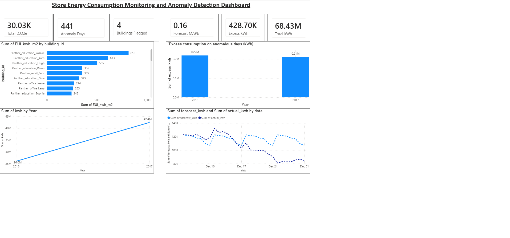

# Store Energy Consumption Monitoring and Anomaly Detection Dashboard

A Python + Power BI project that analyses hourly building electricity data to benchmark energy use, flag abnormal consumption, estimate emissions and test a simple forecast.



## Overview

The Python script cleans raw meter readings, aggregates them to daily consumption and produces four analysis tables. These are loaded into Power BI to build an interactive dashboard.

**What it answers**

- Which buildings use the most energy per square metre?
- On which days did a building consume far more than expected?
- How much CO2e do the buildings emit?
- How well does a simple weekday-based forecast predict the next 28 days?

## Dataset

[Building Data Genome Project 2 (BDG2)](https://github.com/buds-lab/building-data-genome-project-2): hourly electricity readings for 1,578 buildings (2016-2017) and a metadata file with building type and floor area.

The data files are not included in this repository because of their size. Download `electricity.csv` and `metadata.csv` from the BDG2 repository and place them in the project folder.

## Methods

| Step | What it does |
|------|--------------|
| **Selection** | Picks up to 40 buildings, preferring Retail, Office and Education |
| **Cleaning** | Treats negative readings as meter errors, interpolates gaps of up to 6 hours, drops anything still missing |
| **Daily aggregation** | Sums hourly kWh to daily kWh per building |
| **EUI benchmark** | Annualised kWh divided by floor area (kWh/m² per year), compared with the median; buildings above 1,000 kWh/m² are flagged for a data check |
| **Emissions** | Annual kWh x 0.71 kg CO2e/kWh (an assumed emission factor) |
| **Anomaly detection** | Robust z-score (median and MAD over a 28-day rolling window); days with z > 3.5 are flagged, with excess kWh over the expected level |
| **Forecast backtest** | Seasonal-naive by weekday: the average of the same weekday over the 8 weeks before a 28-day test window; error reported as MAPE |

## Requirements

- Python 3.9+
- `pandas`, `numpy`, `matplotlib`
- Power BI Desktop (Windows) to open the dashboard

```bash
pip install pandas numpy matplotlib
```

## Usage

**Real data (BDG2 wide format)**

```bash
python energy_dashboard_project.py --electricity electricity.csv --metadata metadata.csv
```

**Demo mode (synthetic data, no files needed)**

```bash
python energy_dashboard_project.py --demo
```

**ASHRAE-style long format**

```bash
python energy_dashboard_project.py --train train.csv --meta metadata.csv
```

## Output

Results are written to `output_energy/`:

| File | Contents |
|------|----------|
| `daily_consumption.csv` | Daily kWh per building |
| `eui_benchmark.csv` | EUI, emissions, % vs median and data-check flag per building |
| `anomalies.csv` | Flagged days with expected and excess kWh |
| `forecast_backtest.csv` | Actual vs forecast for the 28-day test window |
| `summary.txt` | Key figures from the run |
| `*.png` | EUI benchmark, anomaly trend and forecast charts |

## Power BI Dashboard

The four CSVs are loaded into Power BI and related on `building_id`.

**Visuals**

- KPI cards: total kWh, total tCO2e, anomaly days, buildings flagged, forecast MAPE
- Bar chart: top 15 buildings by EUI
- Line chart: daily electricity consumption
- Line chart: forecast vs actual
- Column chart: excess kWh on anomalous days
- Table: anomaly details
- Slicers: building and primary use

## Project Structure

```
.
├── energy_dashboard_project.py   # data cleaning, analysis and exports
├── output_energy/                # generated CSVs, charts and summary
├── dashboard.pbix                # Power BI dashboard
├── dashboard.png                 # dashboard screenshot
└── README.md
```

## Assumptions and Limitations

- The emission factor (0.71 kg CO2e/kWh) is an assumption; replace it with your local grid factor.
- Annual figures are extrapolated from the days with data, so partial-year buildings are less reliable.
- The forecast is a simple benchmark, not a production model.
- Only electricity is analysed (no gas, water or other meters).

## Author

[asif234ww](https://github.com/asif234ww)
